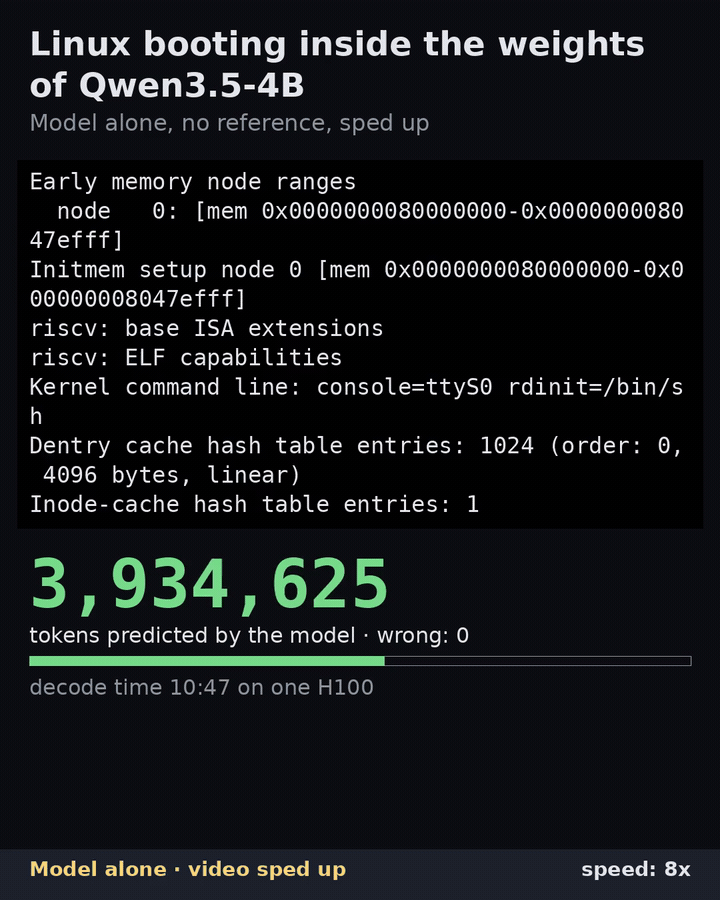
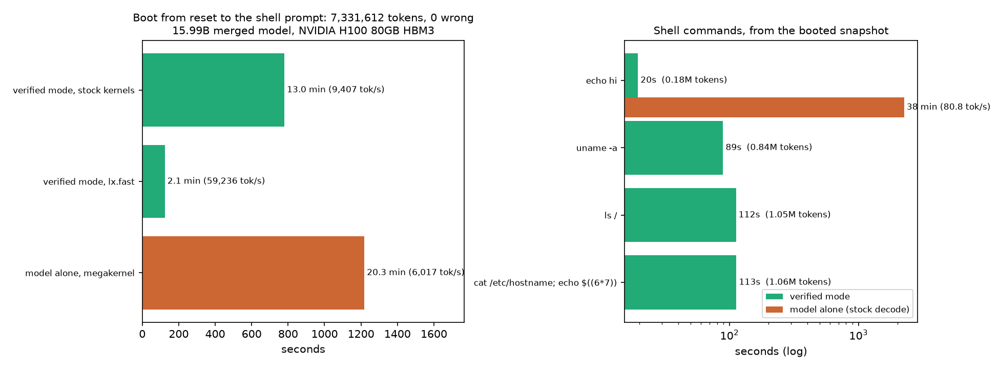
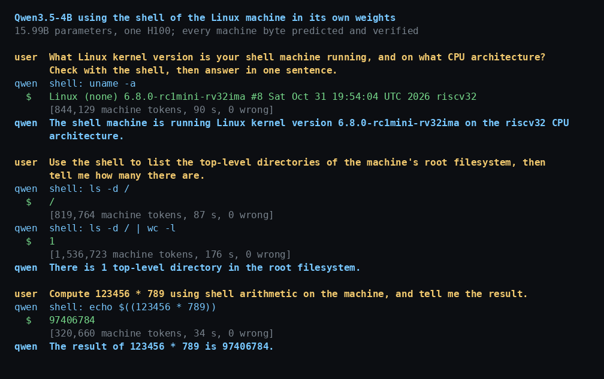

# linuxformer

**Linux boots inside the weights of a stock Qwen3.5-4B, then Qwen uses its shell.**

A Linux-capable RISC-V CPU is compiled into 37 extra transformer layers, with no training. Its RAM
is the layers' Gated DeltaNet state. Linux 6.8 (no-MMU) boots on it to a BusyBox shell, and Qwen's
own 32 layers, bit-identical to the released checkpoint, call that shell as a tool.

Weights: [itsrealranky/linuxformer](https://huggingface.co/itsrealranky/linuxformer) on Hugging
Face, the 32 GB checkpoint and a 634 MB snapshot of the machine booted to its shell prompt.

<p align="center"><a href="assets/hero.mp4"></a></p>

The demo above ([mp4](assets/hero.mp4), 37 s, `lx/tools/render_launch.py hero`), model alone
and sped up (the speed is always on screen): the second half of the boot, then Qwen writes a
Fibonacci script, runs it on the machine, hits an out-of-memory failure, rewrites the script and
answers 4181. The counters and clocks are the runs' own (`mega_boot.json`,
`m7_chat_fib_alone.json`). Also: the [whole boot](assets/boot_timelapse.mp4) at 40x and the
[kernel's boot log](assets/dmesg_4x.mp4) at 4x. Every byte on screen is one the model predicted.



## What is in the weights, exactly

- **The CPU**: RV32IMA + Zicsr with M/U modes, traps, a CLINT timer, and an 8250 UART for output
  and keyboard input. It executes exactly what [mini-rv32ima](https://github.com/cnlohr/mini-rv32ima)
  executes, apart from misaligned accesses and the zicntr counters. It doesn't implement those,
  and the reference stops if a trace needs them; the boot and the shell runs here never did. A
  compiler computes the weights of 37 Qwen3.5-shaped layers (Gated DeltaNet + SwiGLU):
  3,572 residual dims, 497 GDN heads, 36,716 SwiGLU units. The circuit uses no full attention:
  only the GDN recurrent state and the 4-tap conv window.
- **Its memory**: 4.5 MB of RAM and the kernel's 1 MB of text (a read-only ROM) are rows of GDN
  recurrent state. At reset, the kernel Image (with its BusyBox initramfs) and the device tree
  are written into that state, like a bootloader copying an image into RAM. From then on,
  every token comes from the model.
- **How it runs**: every machine step is a short record of tokens (a register write, a jump, a
  store, a UART byte...). The model predicts the next token, and its state is the machine's
  state. The host only ever types: GO at reset, and keyboard bytes at record boundaries.
- **Qwen**: the merged checkpoint (`lx/merge.py`) is one `Qwen3_5ForCausalLM` at Qwen's hidden size
  (2560). It holds 37 chip layers, then Qwen3.5-4B's 32 layers, with 15.99B parameters. All 426
  of Qwen's tensors are bit-identical to the release. The vocabulary is Qwen's 248,320 tokens
  followed by the chip's 459,982 tokens.
  - **Routing**: tokens are routed by kind, as [Qwenputer](https://github.com/divagr18/qwenputer)'s
    RvChat does. Chip tokens run only the chip layers, and text tokens run only Qwen's layers
    (`text_view`, a stock model sharing those modules). A plain `generate()` over all 69 layers
    is not how this model runs.
  - **The one config change**: Qwen's GDN layers are zero-padded to the chip's shape (256-dim key
    heads, 128 value heads). The padding changes the query scale, which halves the GDN output's
    square ahead of the gated RMSNorm. To cancel that exactly, the merged config's
    `rms_norm_eps` is halved (1e-6 to 5e-7). The derivation is in `lx/merge.py`.

## Three modes

- **Model alone.** Plain greedy decoding with no reference: the model's argmax is its next
  input. `lx/csrc/mega.cu` runs the whole decode step in one persistent kernel on all 132 SMs
  of an H100 and keeps the next token on the GPU. It decodes in 262,144-token chunks; between
  chunks the host passes only the model's own last prediction, and types GO and keystrokes.
  - Boot from reset to the shell prompt: 7,331,612 tokens in 20.3 minutes (6,017 tok/s),
    identical to the reference. That excludes loading the model (25 s from the export, 95 s
    when building it from Qwen's checkpoint) and building the megakernel's tables (1 s).
  - A second run from a clean checkout matched the first: the same tokens, console and final
    state. The kernel records the input it embeds at every step: GO, then only the model's own
    predictions.
  - The stock decode, for comparison, runs at 80.8 tok/s.
  - The megakernel uses optimistic scheduling with check-and-redo. GDN layers that rarely write
    are scheduled together; each checks whether it wrote, and the layers after one that did are
    redone in order. It never changes outputs; the schedule was chosen from measured activity
    and only affects speed.
  - `Linux.boot_alone` and `lx.chat --alone` run shell commands this way.
- **Verified mode.** mini-rv32ima proposes the trace and the model checks every token in chunked
  prefill; one wrong token stops the run.
  - The proposer is `lx/ref.py`. It matches `ref/lxtrace.c` on the unmodified `mini-rv32ima.h`
    token for token, over the whole boot and every supported riscv-test.
  - The boot takes 13.0 minutes with the stock kernels, or 2.1 with `lx/fast.py` (below).
- **Self-drafting** (not built): the model drafting its own continuation for prefill to check.

`lx/fast.py` is a second forward over the same published tensors that skips their zeros (the
chip weights are 0.08% nonzero): only nonzero rows and columns, and only GDN heads with work to
do. It uses the same kernels (fla, cuBLAS), with the steps between them compiled by
`torch.compile` to round where eager PyTorch rounds; nothing about the CPU is written by hand.
Its boot ends in the stock boot's state to the bit. `--fast` selects it in `lx.linux`, `lx.chat`
and the Space; `--lean` also keeps the chip layers' projections in host memory, for a GPU
budget of 22 GiB.

Verified mode is teacher forcing. It checks the model's prediction at every position given the
correct prefix. Because every prediction in the boot is correct, the model fed its own outputs
would produce the same stream. Model-alone runs show that directly: the whole boot (twice, on
the megakernel), `echo hi` from the booted state, and a UART echo program
under five typing schedules (`lx/tests/check_session.py`).

## Results

Every number below is in [`lx/results/summary.md`](lx/results/summary.md), which
`lx/tools/summary.py` generates from the results files. All runs used one NVIDIA H100 80GB in bf16.

A boot is 7,331,612 tokens: GO, which the host types at reset, then 7,331,611 tokens the model
predicts. Verified-mode rows count the 7,331,611 predictions checked; model-alone rows count the
whole stream.

| | |
|---|---|
| Boot, reference | 5,418,133 instructions; 5,503,225 records; 7,331,612 tokens |
| Boot, model alone (megakernel) | 7,331,612 tokens identical to the reference in 1,218.4 s = 20.3 min (6,017 tok/s); console identical (2,340 bytes); peak 34.3 GB. Not included: loading the model (25 s from the export, 95 s building it from Qwen's checkpoint) and building the megakernel's tables (1.0 s) |
| Second model-alone boot | from a clean checkout: the same stream (SHA-256 equal to the reference's), console and final state (0 of 158,826,496 elements differ); 20.3 min. The kernel's record of its inputs: GO, then only the model's own predictions |
| Final state, model alone vs verified mode | identical: 0 of 158,826,496 elements differ |
| Boot, verified mode, merged model (16B) | 0 wrong of 7,331,611 predictions in 779.4 s (9,407 tok/s); console identical (2,340 bytes) |
| Boot, verified mode, chip-only model (14B) | 0 wrong of 7,331,611 in 822.3 s (8,916 tok/s), peak 70.5 GB |
| Boot, verified mode, `lx.fast` | 0 wrong of 7,331,611 in 123.8 s = 2.1 min (59,236 tok/s, 6.3x stock); final state identical to the stock boot (0 of 158,826,496 elements differ) |
| Determinism | two boots at prefill chunk 65,536 and 32,768: 0 of 158,826,496 state elements differ |
| Snapshot load | about 1 s once the model is up (95 s to build it from Qwen's checkpoint, 25 s to load the export), then the shell is live |
| Checkpoint | 31.98 GB in 7 safetensors shards (945 tensors), reloaded equal to the build bit for bit; booted snapshot 634 MB (safetensors) |
| Qwen writes a script (model alone) | Fibonacci session on the megakernel: 12,525,912 machine tokens in 36.1 min, identical to the reference, 350 keystrokes typed at record boundaries, peak 35.6 GB; Qwen recovered from an out-of-memory failure and answered 4181 |
| Qwen writes a script (verified mode) | Fibonacci session: 12,419,654 machine tokens in 22.5 min, 0 wrong, peak 55.8 GB; Qwen recovered from an out-of-memory failure and answered 4181 |
| Shell, verified mode | `echo hi` 183k tokens / 20 s; `uname -a` 838k / 89 s; `ls /` 1.05M / 112 s |
| Shell, model alone (megakernel) | a 4-line, 89-byte input (`tests/check_alone.py`): 1,171,544 tokens in 200 s (5,865 tok/s), identical to the reference; 89 keystrokes typed at record boundaries, every other input the model's own prediction |
| Shell, model alone (stock decode) | `echo hi` 182,054 tokens in 2,254.2 s (80.8 tok/s), identical to the reference; `lx.fast` decode 439.7 tok/s, bit-identical to the stock decode |
| Model alone, UART | 5/5 typing schedules identical to the reference, with save/load in the middle of each run |
| CPU tests | riscv-tests 135/135 supported runs exact (IR, and GPU prefill + token-by-token decode); RAM test 0 wrong of 8.4M |
| Qwen weights | 0 of 426 tensors differ |
| Qwen text, 8 prompts | KL 6.0e-4 vs noise floor 5.5e-4 (sdpa vs eager); top-1 99.0%; greedy 7/8 identical |
| MMLU, 14,042 questions | stock 72.72%, merged 72.61%, same answer as stock 98.55%, KL 5.8e-4 |
| MMLU noise floor | stock with eager attention instead of sdpa: 72.70%, same answer as stock 98.50%, KL 4.5e-4 |

Qwen using the shell (`lx/chat.py`, results in `lx/results/m6_chat.json`):



- *"What Linux kernel version...?"* Qwen called `uname -a`, which printed
  `Linux (none) 6.8.0-rc1mini-rv32ima ... riscv32`. Qwen answered correctly.
- *"Compute 123456 * 789 using shell arithmetic"* Qwen called `echo $((123456 * 789))`, which
  printed `97406784`. Qwen answered correctly.
- *"How many top-level directories?"* Qwen ran `ls -d /` and `ls -d / | wc -l` and answered "1".
  The machine's outputs were correct, but the command was the wrong one: `ls /` lists 7.

Qwen writing and running a program, model alone (`lx/results/m7_chat_fib_alone.json`, one
session from the booted snapshot, on the megakernel): asked for a script that prints the first 20
Fibonacci numbers, Qwen wrote `/tmp/fib.sh` looping over `$(seq 1 20)`. `seq` failed with a kernel
page-allocation failure and `binfmt_flat: Unable to allocate RAM for process text/data`
(5,755,042 machine tokens, 994.2 s). Qwen read the error, rewrote the loop with shell builtins
(6,770,870 tokens, 1,168.9 s), and answered 4181, which is correct. Total: 12,525,912 machine
tokens in 36.1 min, identical to the reference typed at the same places, 0 wrong, peak 35.6 GB.
The same session in verified mode (`lx/results/m7_chat_fib.json`): the same two scripts,
12,419,654 machine tokens in 22.5 min, 0 wrong, peak 55.8 GB. The model-alone traces are longer
because its driver sees the receive FIFO empty only at the end of a launch, so it types each
batch of keystrokes a little later. Qwen's first reply is the same with the model built, loaded
from the export, and loaded with lx.fast (`lx/results/qwen_first_reply.json`).

## Limitations

- **Speed.** The model alone runs at about 6,000 tokens/s only with the megakernel, which is
  written for the H100 (132 SMs, 227 KB of shared memory per block). It has no plain
  `generate()` path: tokens are routed by kind, and the host drives 262,144-token chunks. The
  stock decode is 80.8 tokens/s and `lx.fast`'s 439.7. The megakernel's boot is about 4,450
  RISC-V instructions per second, against 43,800 in verified mode with `lx.fast`.
- **Command cost.** The builtin `echo hi` costs 0.18M tokens (20 s in verified mode). The
  external commands measured cost 0.84–1.06M tokens (89–113 s). Where those instructions go
  hasn't been profiled. The likely cost is a vfork and loading the 326 KB FLAT BusyBox binary on
  a no-MMU kernel.
- **Text behavior.** Qwen's outputs are not bit-identical to stock. The merged model agrees with
  stock on MMLU answers (98.55%) as often as stock agrees with itself under a different attention
  kernel (98.50%). Its KL, though, is 1.1–1.3x that kernel noise floor, and its accuracy is 0.11
  points lower (eager: 0.02 lower).
- **Machine size.** The machine has 4.5 MB of RAM, no MMU and no disk. State persists only as a
  snapshot of the GDN state, 634 MB. Without an MMU, each exec needs one contiguous block for
  the program (in the Fibonacci session the failed request was order 7: 128 pages, 512 KB).
  After a few execs, RAM can be too fragmented for that, and the kernel prints a
  page-allocation failure. Shell builtins don't need the block.
  `lx.chat` reloads the booted snapshot before each question.
- **Targets not reached.** Booting costs 1.35 tokens per instruction, not the ~1 aimed for.
  Shell commands cost more: `uname -a` 1.47, `echo hi` 1.77, and the 20-step Fibonacci
  `while` loop 2.47 (`lx/tools/cost.py`, `lx/results/cost.json`), because each instruction
  fetched from RAM rather than the kernel's ROM costs two extra tokens: its instruction word,
  in two 16-bit halves.
- **CPU coverage.** The CPU does not implement misaligned accesses or the zicntr counters. The
  riscv-tests for those, 8 of 76 programs, are not run.
- **Kernel changes.** The kernel carries one small patch of ours,
  `kernel/patches/0003-*.patch`. It adds config options that keep the kernel text read-only
  after boot, since the ROM can't be written, and that skip a timing probe.

## Reproduce

```bash
pip install -r requirements.txt     # Python 3.11, CUDA 13
scripts/setup.sh                    # upstream sources at pinned commits, toolchain, Qwen3.5-4B, MMLU
cd lx
export PYTHONPATH=. PYTORCH_CUDA_ALLOC_CONF=expandable_segments:True
python tests/check_ref.py rvtests; python tests/check_ref.py linux 5503225   # results/ref_vs_c.log
python tests/check_core.py rvtests                       # results/ir_rvtests.log (CPU circuit, exact arithmetic)
python tests/check_core.py uart                          # results/ir_uart.log
python tests/check_hf.py rvtests --decode 64             # results/hf_rvtests.log (GPU, bf16)
python tests/check_hf.py uart --decode 400               # results/hf_uart.log
PYTHONPATH=.:tests python tests/check_session.py         # results/session_uart.log (verified mode, save/load, model alone)
python tests/check_hf.py ramtest --chunk 65536 --out results/m3_ramtest.json
python tests/check_hf.py boot --chunk 65536 --out results/m4_boot.json
python tests/check_merge.py --out results/m6_merge_check.json
python -m lx.linux --merged --snapshot ../build/snapshots/boot-merged.pt --out results/m4_boot_merged.json
python -m lx.linux --merged --out results/m5_shell_merged.json "echo hi" "uname -a" "ls /" 'cat /etc/hostname; echo $((6*7))'
python -m lx.linux --merged --pure "echo hi" --out results/m5_pure_merged.json
python -m lx.chat --out results/m6_chat.json \
    "What Linux kernel version is your shell machine running, and on what CPU architecture? Check with the shell, then answer in one sentence." \
    "Use the shell to list the top-level directories of the machine's root filesystem, then tell me how many there are." \
    "Compute 123456 * 789 using shell arithmetic on the machine, and tell me the result."
python tests/eval_text.py --floor 14042 --out results/m7_mmlu_floor_all.json
python tests/check_snapshots.py A.pt B.pt --boot results/m4_boot_merged.json
python -m lx.chat --out results/m7_chat_fib.json "Write a shell script that prints the first 20 Fibonacci numbers, save it as /tmp/fib.sh, run it on the machine, and tell me the 20th number."
python tools/export_hf.py ../build/hf/model              # results/m8_export.json (reload checked bit for bit)
python -m lx.linux --weights ../build/hf/model --snapshot ../build/hf/model/boot-snapshot.safetensors \
    --out results/m8_export_echo.json "echo hi"          # from the exported files alone
python tools/cost.py --out results/cost.json 'echo hi' 'uname -a' \
    'a=0; b=1; i=1; while [ $i -le 20 ]; do echo $a; c=$((a + b)); a=$b; b=$c; i=$((i + 1)); done'   # CPU only
python -m lx.linux --merged -i                           # an interactive shell
python tools/mega_boot.py --out results/mega_boot.json   # model alone, from reset (H100)
PYTHONPATH=. python tests/check_alone.py --out results/alone_check.json
python tests/check_alone.py --snapshot ../build/hf/model/boot-snapshot.safetensors --cmd "echo hi" \
    --out results/alone_export_echo.json                 # model alone from the exported files
python tests/check_qwen_reply.py --out results/qwen_first_reply.json
python -m lx.chat --alone --weights ../build/hf/model --snapshot ../build/snapshots/boot-merged-mega.pt \
    --out results/m7_chat_fib_alone.json "Write a shell script that prints the first 20 Fibonacci numbers, save it as /tmp/fib.sh, run it on the machine, and tell me the 20th number."
python tools/summary.py && python tools/plot_results.py ../assets/results.png
python tools/render_chat.py results/m6_chat.json ../assets/chat.png
python tools/record_video.py boot --out results/video_boot.json \
    --snap 1000000 3808155 3817870 3842780 5000000                   # model alone, stream + snapshots (H100)
python tools/record_video.py session --out results/video_fib.json    # then the Fibonacci session
PYTHONPATH=.:tools python tools/render_launch.py hero ../assets/hero.mp4    # CPU only, from results/
ffmpeg -i ../assets/hero.mp4 -loop 0 -vf "fps=15,scale=720:-1:flags=lanczos,split[a][b];[a]palettegen=max_colors=256:stats_mode=diff[p];[b][p]paletteuse=dither=bayer:bayer_scale=3:diff_mode=rectangle" ../assets/hero.gif
PYTHONPATH=.:tools python tools/render_launch.py timelapse ../assets/boot_timelapse.mp4 --speed 40
PYTHONPATH=.:tools python tools/render_launch.py dmesg ../assets/dmesg_4x.mp4 --speed 4
cd .. && make video   # the video from results/video_*.json: build/video/out/ (Node >= 22.20, ffmpeg)
```

Qwen's text generation isn't bit-reproducible from run to run, so a rerun of `lx.chat` can write a
different script. Whatever it types, the machine's side is exact: checked token by token in
verified mode, compared with the reference afterwards when the model runs alone.

The first `lx.linux --merged` run boots from reset and saves the snapshot. Later runs load it.
Run one GPU job at a time: the merged model and its prefill activations fill an 80 GB card.

## Layout

| path | what |
|---|---|
| `lx/lx/spec.py`, `ref.py` | tokens and records; the Python reference machine (equal to `ref/lxtrace.c` on mini-rv32ima.h) |
| `lx/lx/core.py`, `ir.py`, `prims.py`, `graph.py` | the CPU as a circuit of GDN heads and SwiGLU units |
| `lx/lx/emit.py`, `hf.py` | circuit to Qwen3.5 weights; chunked prefill |
| `lx/lx/merge.py` | the merged model (chip layers + stock Qwen3.5-4B) |
| `lx/lx/session.py`, `linux.py`, `chat.py` | verified mode / model alone / snapshots; boot and shell; Qwen's shell tool |
| `lx/lx/fast.py`, `fast_kernels.py` | the same forward, skipping the weights' zeros |
| `lx/csrc/mega.cu`, `lx/lx/mega.py`, `mk_build.py` | the megakernel: a whole decode step in one persistent kernel |
| `kernel/` | `Image` (the image every result booted), `patches/`, `linux.config`, build scripts |
| `userland/` | BusyBox `busybox.config`, `patches/`, build script |
| `phase1/` | the feasibility measurements (boot instruction counts, prefill exactness/throughput) |

## Licenses and credits

The code in this repository is MIT ([LICENSE](LICENSE)). It builds on:

- **Qwenputer / chipformer** by Divyansh Agrawal (MIT): the circuit compiler design, the
  gadgets, the DIV/REM recurrence and the multiplier. `lx/ir.py`, `prims.py`, `graph.py` and
  `emit.py` are derived from it, and their headers say so.
- **mini-rv32ima** by CNLohr (MIT): the reference core (`ref/*.c` build against its
  `mini-rv32ima.h`), the machine spec and the buildroot configuration.
- **Linux** (GPL-2.0): `kernel/Image` is built from kernel.org Linux 6.8-rc1 plus
  `kernel/patches/` (0001–0002 from mini-rv32ima's buildroot, 0003 ours) with
  `kernel/linux.config`.
- **BusyBox** (GPL-2.0): 1.36.1 plus buildroot's patches, with `userland/busybox.config`. It
  is the initramfs linked into the Image. `scripts/setup.sh` fetches and rebuilds the kernel
  and BusyBox from source and checks the tarballs' SHA-256s. See [NOTICE](NOTICE).
- **uClibc-ng** 1.0.44 (LGPL-2.1), statically linked into the BusyBox binary.
- **Qwen3.5-4B** by the Qwen team (Apache-2.0): its weights are used unchanged.

Related work: [qwenputer-linux](https://github.com/Franzferdinan51/qwenputer-linux) boots Linux
on a reference machine for Qwenputer. Its README, as of 2026-11-02, says the in-weights port is
not done.
